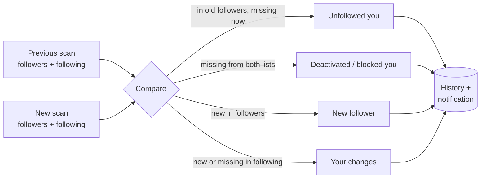
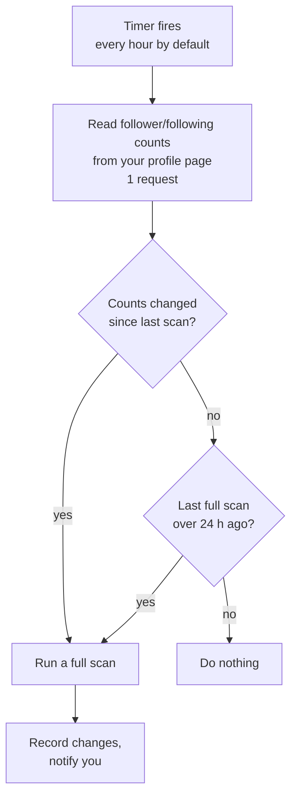

# Unfollow Watch for Instagram

A Chrome extension that tracks your Instagram followers and following and tells you **exactly who unfollowed you**: with dates, desktop notifications, and a one-click way to unfollow them back.

Instagram only shows your follower *count*. When it drops from 3,000 to 2,996 there's no way to see who left. Unfollow Watch saves your full followers and following lists, compares every new scan with the previous one, and keeps a dated history of every change.

<p align="center">
  
  &nbsp;
  
</p>

> **Not affiliated with Instagram or Meta.** This extension uses Instagram's own website endpoints with your existing login. Read [Risks and limitations](#risks-and-limitations) before using it.

---

## Contents

- [Features](#features)
- [Installation](#installation)
- [Getting started](#getting-started)
- [How it works](#how-it-works)
- [Why a scan takes several minutes and takes breaks](#why-a-scan-takes-several-minutes-and-takes-breaks)
- [Why "Unfollow all" unfollows only about one account a minute](#why-unfollow-all-unfollows-only-about-one-account-a-minute)
- [Importing your Instagram data download](#importing-your-instagram-data-download)
- [Privacy and permissions](#privacy-and-permissions)
- [Troubleshooting](#troubleshooting)
- [FAQ](#faq)
- [Project structure](#project-structure)
- [Risks and limitations](#risks-and-limitations)

---

## Features

### See who unfollowed you
- **Activity → Unfollowed you** lists everyone who stopped following you, grouped by day (*Today*, *Yesterday*, *Mon, Nov 2*…).
- Each entry says whether **you still follow them**. If you do, there's an **Unfollow** button right there.
- It also shows **how long they had followed you** before leaving (*followed you for 2 yr 3 mo*).
- Accounts that vanished from *both* your lists are labelled **Deactivated, deleted, or blocked you**, so they aren't counted as normal unfollows.

### Current counts at a glance
- **Followers** and **Following** as Instagram reports them right now, plus the change at the last scan (`+12 −5`).
- **Don't follow back**: how many accounts you follow that don't follow you, and how many of them unfollowed you since you started tracking.
- If your counts on Instagram change between scans, a note tells you (*Instagram shows −4 followers since your last scan*) with a link to scan.

### Your full lists, searchable
| Tab | Filters |
| --- | --- |
| **Activity** | Unfollowed you · New followers · Your changes (who *you* followed/unfollowed) · Since download |
| **Following** | All · Unfollowed you · Don't follow back · New (last 7 days) |
| **Followers** | All · Loyal (longest-following first) · You don't follow · New (last 7 days) |

All lists are searchable by username or name. Long lists load as you scroll, so 5,000+ accounts stay fast.

### Act on it
- **Unfollow** and **Follow back** buttons on every relevant row.
- **Unfollow all**: unfollows everyone who doesn't follow you back, slowly and safely, in the background ([why it's slow](#why-unfollow-all-unfollows-only-about-one-account-a-minute)).

### Stay informed
- **Desktop notifications** when someone unfollows you. If it's one person, the notification has an **Unfollow** button.
- Optional notifications for new followers.
- The toolbar **badge** counts unfollows you haven't looked at yet.
- **Automatic checks** in the background while Chrome is open.

### Follow dates (optional)
Import Instagram's own data download to see **the exact date each follower followed you**, sort followers by loyalty, and find people who unfollowed you **before you installed the extension**. See [Importing your Instagram data download](#importing-your-instagram-data-download).

<p align="center">
  
  &nbsp;
  
</p>

---

## Installation

The extension isn't on the Chrome Web Store. You install it directly from this repository. It takes about a minute.

It works in **Google Chrome**, **Microsoft Edge**, **Brave** and other Chromium browsers.

### 1. Download the code

**Option A: download the release (recommended, no tools needed)**
1. Open the [latest release](https://github.com/Reshaan-Nadar/unfollow-watch/releases/latest) and download `unfollow-watch-<version>.zip` under **Assets**.
2. Extract the ZIP to a folder you'll keep, for example `Documents`. You'll get a folder named `unfollow-watch-<version>`.
   The browser runs the extension from this folder, so don't delete or move it afterwards.

**Option B: clone with Git**
```bash
git clone https://github.com/Reshaan-Nadar/unfollow-watch.git
```

### 2. Load it into your browser

1. Open the extensions page:
   - Chrome: `chrome://extensions`
   - Edge: `edge://extensions`
   - Brave: `brave://extensions`
2. Turn on **Developer mode** (a toggle in the top-right corner, or the left sidebar in Edge).
3. Click **Load unpacked**.
4. Select the folder that contains `manifest.json`. If you downloaded the release, it's the extracted `unfollow-watch-<version>` folder.
5. Click the puzzle-piece icon in the toolbar and **pin** Unfollow Watch so it's always visible.

### 3. Log in to Instagram

Open <https://www.instagram.com> in the **same browser** and log in. The extension uses this login and never asks for your password.

### Updating

- **Release ZIP:** download the newest release and replace the files in your folder with the new ones.
- **Git:** run `git pull` in the folder.

Then open `chrome://extensions` and click the **reload** icon (↻) on the Unfollow Watch card. Your saved lists and history are kept.

> Chrome may sometimes show a banner about extensions in developer mode. That's normal for extensions installed this way. Dismiss it, and keep the extension enabled.

---

## Getting started

1. Click the Unfollow Watch icon, then **Run first scan**.
2. Wait for the scan to finish. For about 3,000 followers and 2,800 following, it takes around **7–8 minutes** ([why](#why-a-scan-takes-several-minutes-and-takes-breaks)). You can close the popup; the scan keeps running.
3. The first scan saves a **baseline**: a snapshot of who follows you and who you follow. It immediately shows **who doesn't follow you back**.
4. From then on, every scan is compared with the previous one. Anyone who unfollows you shows up in **Activity**, and you get a notification.

You don't need to scan by hand after that. The extension checks for changes in the background ([how](#automatic-background-checks)).

<p align="center">
  
</p>

---

## How it works

### Detecting unfollows

Instagram doesn't tell anyone who unfollowed them. The only way to find out is to compare the full followers list at two points in time. That's what the extension does:



Every change is saved with the time of the scan that found it, so the history builds up over time. Unfollows are tracked from your **first scan** onward, because Instagram keeps no record of earlier ones. To look further back, use a [data download](#importing-your-instagram-data-download).

### Automatic background checks

A full scan reads every account in both lists, which is over a hundred requests for a mid-sized account. Running that every hour would get the account rate-limited. So the extension checks cheaply first:



- The check costs **one request**, the same as opening your profile.
- A **full scan** runs only when the numbers moved, or once a day. The daily scan catches cases where one person unfollowed and another followed, leaving the count unchanged.
- The interval is set in **Settings → Check for changes**: every 30 min, 1 h, 3 h or 6 h, or Off.
- Checks run in the background as long as **Chrome is open**. The popup doesn't need to be open. Nothing runs while Chrome is closed or the computer is asleep; the next check after that catches up.

### Where the data comes from

The extension calls the same internal endpoints that instagram.com uses when you open your own followers list. It authenticates with your browser's existing Instagram login, so nothing is scraped from a separate session, and your password is never involved.

- **Followers and following** are read 50 accounts at a time.
- **Following** is requested sorted by date followed. Instagram's default order reshuffles while you page through it, which would skip and repeat accounts.
- **Counts** are read from your profile page (*"3,950 Followers, 3,554 Following"*).
- If Instagram refuses a request from the extension, it's retried from inside an instagram.com tab, exactly as the website would send it. When **you** start a scan or an unfollow and no instagram.com tab is open, the extension opens one in the background and closes it about a minute after it's done. Timed background checks never open tabs.
- **Follow and unfollow** requests include the anti-forgery token (`fb_dtsg`) that Instagram requires. It's read from a logged-in instagram.com page and cached for 30 minutes.

### Safeguards against false alerts

| Situation | What the extension does |
| --- | --- |
| Instagram returns an incomplete list (for example, 1,200 of 3,000 followers) | The scan is **discarded** if it got less than 80% of the expected accounts. It isn't saved, so you don't get hundreds of fake "unfollowed you" alerts. |
| An account deactivated, was deleted, or blocked you | If it disappears from **both** your followers and your following, it's labelled *Deactivated, deleted, or blocked you*, not *unfollowed*. |
| Someone unfollows and follows again | They show as *Followed you again* and drop off the "Unfollowed you" lists. |
| The browser closes mid-scan | The partial scan is thrown away; your last complete scan stays as it was. |

---

## Why a scan takes several minutes and takes breaks

**Short answer:** reading thousands of accounts as fast as possible looks like a bot to Instagram. Going slowly keeps your account safe and keeps the scan from being cut off halfway.

### What a scan actually does

Instagram hands out lists **50 accounts at a time**. To read 3,000 followers, the extension asks for page 1, then page 2, and so on: 60 requests just for followers, plus more for following.

A human scrolling through their followers list loads a new page every few seconds. A script with no pauses could fire all 60 requests in under 10 seconds. Instagram watches for exactly that pattern. When it sees it, it:

- answers **"Please wait a few minutes before you try again"** (HTTP 429) and stops returning data, so the scan can't finish;
- may temporarily **restrict the account** or ask you to verify it's you;
- may even return **partial lists**, which would look like a wave of unfollows.

### How the extension paces itself

| Rule | Value | Why |
| --- | --- | --- |
| Pause between pages | **2–4 seconds**, random | Looks like someone scrolling, not a fixed-interval script |
| Longer break | **15–30 seconds every 30 pages** | Breaks up long runs of requests on large accounts. The popup says *"Taking a short break so Instagram doesn't limit the scan…"* |
| If Instagram says "slow down" mid-scan | Waits **2 minutes**, then **5 minutes**, then gives up | The pages already read are kept while it waits, so the scan isn't lost |
| Minimum time between scans | **15 minutes** | The **Scan** button shows a countdown (*Scan in 14:59*) |
| After a real rate limit | Pauses **all** requests for **30 min**, doubling each time it happens again in a row (1 h, 2 h, 4 h, at most 6 h) | Retrying during a limit makes it last longer. The first successful request afterwards resets the pause. |

### How long to expect

Roughly **3.5 seconds per 50 accounts**, plus breaks. Your followers and following are counted together:

| Followers + following | Pages | Approximate time |
| ---: | ---: | ---: |
| 1,000 | 20 | ~1–2 min |
| 3,000 | 60 | ~4 min |
| 6,000 | 120 | ~7–8 min |
| 10,000 | 200 | ~13–14 min |

The following list often loads faster than this, because sorted by date Instagram can return it in fewer pages. The popup shows a live progress bar (*Reading your followers · 1,250 of 3,000*), and the empty state estimates the time for your account before the first scan.

**You don't have to watch it.** Close the popup and keep browsing; the scan runs in the background and the result is there next time you open it.

---

## Why "Unfollow all" unfollows only about one account a minute

**Short answer:** Instagram blocks accounts that unfollow in bursts. One account every 45–90 seconds, at most 150 a day, stays well clear of that. And because it runs in the background, the slow pace doesn't cost you anything.

### Instagram's action limits

Follows and unfollows are "actions", and Instagram limits how many you can do per hour and per day. It doesn't publish the exact numbers, and they vary with the account's age and history. Go over them and you get the **"Try Again Later"** / **"Action Blocked"** message:

- you can't follow or unfollow anyone, even by hand in the app, for **hours to days**;
- repeated blocks last longer and can lead to further restrictions on the account.

Unfollowing 400 accounts in a few minutes is exactly the kind of burst that triggers this.

### How "Unfollow all" paces itself

| Rule | Value |
| --- | --- |
| Gap between unfollows | **45–90 seconds**, random (about one a minute on average) |
| Daily maximum | **150 unfollows**, then it waits until after midnight and continues on its own |
| If Instagram shows "Try Again Later" | **Stops immediately** and tells you. Wait a day or two before pressing **Resume**. |
| If Instagram rate-limits | Waits out the pause, then continues |
| Two unfollows in a row fail | Pauses and shows the error, rather than failing the whole list |

Before **each** unfollow, it checks your latest scan and **skips anyone who has followed you back** (or whom you already unfollowed) since the list was made. Background checks keep that scan up to date while the queue runs.

### It runs in the background

You click **Unfollow all** once and can then close the popup and use your computer normally:

- It keeps going while **Chrome is open**, even with the popup closed.
- It **survives browser restarts** and picks up where it left off.
- A bar shows progress (*88 of 400 done · Next unfollow in 0:48*) with **Pause** and **Stop**.
- You get a notification when it **finishes** or if it has to **pause**.

| Accounts to unfollow | Approximate time |
| ---: | --- |
| 50 | ~1 hour |
| 150 | ~3 hours (one day's maximum) |
| 400 | 3 days (150 + 150 + 100) |
| 1,000 | 7 days |

To prevent mistakes, **Unfollow all** only starts from a **complete scan less than a day old**, and it only touches accounts that, according to that scan, you follow and that don't follow you.

> The single **Unfollow** button on a row works immediately. The pacing only applies to *Unfollow all*. If you click through dozens of single unfollows quickly, Instagram can still block you, so the same advice applies.

---

## Importing your Instagram data download

Instagram lets you download your own data, including **every follower with the date they followed you**. Importing it adds:

- **Exact follow dates** on every follower (*Since Mar 3, 2021 · 5 yr 8 mo*) and the **Followers → Loyal** sort.
- **Activity → Since download**: with an older download, everyone who followed you then but doesn't now. This covers unfollows from **before** you installed the extension.

### How to get it

1. In Instagram, open **Accounts Center → Your information and permissions → Download your information**.
2. Choose **Download or transfer information → Some of your information → Followers and following**.
3. Pick **Download to device**, format **JSON**, and request it. Instagram emails you when it's ready, which can take minutes to a few days.

### How to import

Open **Settings → Import Instagram data download** and pick:
- the `.zip` file exactly as Instagram sent it (any part of a multi-part download, any size), **or**
- the extracted `followers_1.json` or `followers_1.html` (older downloads use `connections.json`).

Notes:
- Files are read **locally in your browser**. Only usernames and follow dates are kept.
- You can import several downloads. The **oldest** one is the comparison base for *Since download*, and follow dates from all of them are combined.
- Downloads list usernames, not account IDs. An account that **changed its username** or deactivated will therefore also appear under *Since download*.
- If the download looks like it belongs to a different account (fewer than 20% of its followers follow you now), you're asked before it's imported.

---

## Privacy and permissions

- **Everything stays in your browser.** Lists, history and settings are stored in `chrome.storage.local`, per Instagram account. There is no server, no analytics and no tracking.
- **Requests go only to Instagram** (`instagram.com`, plus its image servers for profile pictures).
- **Your password is never seen or stored.** The extension uses the login session your browser already has.
- **Settings → Clear saved data** deletes the saved lists, history and import for the current account.

| Permission | What it's used for |
| --- | --- |
| `storage`, `unlimitedStorage` | Saving your lists and history locally. Large accounts can exceed the default 10 MB. |
| `cookies` | Reading which Instagram account is logged in (`ds_user_id`) and the CSRF token Instagram requires on requests. |
| `alarms` | Scheduling background checks and the paced *Unfollow all* queue. |
| `notifications` | Unfollow alerts, and *Unfollow all* finished or paused. |
| `scripting` | Running a request inside an instagram.com tab when Instagram refuses it from the background. |
| `declarativeNetRequestWithHostAccess` | Setting the `Origin`/`Referer` headers to instagram.com on the extension's own requests, which Instagram requires. |
| Host access: `instagram.com`, `cdninstagram.com`, `fbcdn.net` | Talking to Instagram and loading profile pictures. |

---

## Troubleshooting

| Message or problem | What it means and what to do |
| --- | --- |
| **Log in to Instagram** / **Not logged in** | Open instagram.com in the same browser and log in, then reopen the popup. |
| **Scan in 14:59** (button greyed out) | Scans are spaced 15 minutes apart. Wait for the countdown. |
| **Instagram is limiting requests… paused until 3:45 PM** | Instagram rate-limited the account. The extension waits on purpose; retrying now would extend the limit. It resumes on its own. |
| **Instagram returned only 1,204 of 3,000 followers. The scan was discarded…** | Instagram sent an incomplete list. Nothing was saved. Try again later. |
| **Instagram refused the request from the extension** | Open instagram.com in a tab, make sure you're logged in, and scan again. |
| **Couldn't get Instagram's security token for this action** | Follow/unfollow needs a logged-in instagram.com page. Open instagram.com, then retry. |
| **Instagram blocked this action for now ("Try Again Later")** | An Instagram action block. Stop unfollowing for a day or two. *Unfollow all* pauses itself when this happens. |
| **The last scan was interrupted** | Chrome closed or restarted mid-scan. Run it again. |
| A blank instagram.com tab appeared | The extension opened it to send your scan or unfollow through instagram.com. It closes itself about a minute later. |
| You switched Instagram accounts | Each account has its own data. *Unfollow all* pauses until you switch back. |
| Nothing happens after updating the files | Click **reload** (↻) on the extension's card in `chrome://extensions`. |

---

## FAQ

**Can it show who unfollowed me before I installed it?**
Not from scans; Instagram keeps no history of unfollows. But if you have an **older data download**, importing it shows everyone who followed you then and doesn't now. See [Importing your Instagram data download](#importing-your-instagram-data-download).

**Does my computer need to stay on?**
Chrome needs to be open for background checks and *Unfollow all* to run. If it's closed, nothing is lost; checks resume and the queue continues the next time Chrome runs.

**Does it work on my phone?**
No. Instagram's mobile apps don't support extensions, and mobile Chrome doesn't support them either.

**Will Instagram ban me for using this?**
The extension is built to behave like a person using instagram.com: paced requests, breaks, backing off on limits, and capped unfollows. But it does use Instagram's unofficial internal endpoints, and automated use can go against Instagram's Terms of Use. There is always some risk. See [Risks and limitations](#risks-and-limitations).

**Does it work with multiple accounts?**
Yes. Data is stored separately for each Instagram account. It follows whichever account is logged in on instagram.com in that browser.

**Why is a follower's date shown as "Since before Nov 4"?**
Without a data download, the extension only knows they were already following you at your first scan. Import a download to get exact dates.

---

## Project structure

```
├── manifest.json        Extension manifest (Manifest V3)
├── background.js        Service worker: Instagram requests, scans, diffing, history,
│                        rate-limit handling, background checks, Unfollow all queue,
│                        notifications and badge
├── popup.html           The popup interface (also opens in a full tab from notifications)
├── popup.css            Styles, light and dark mode
├── popup.js             Popup logic: lists, filters, search, actions, settings
├── import.js            Reads Instagram data downloads (zip, zip64, JSON, HTML) in the browser
├── icons/               Toolbar and notification icons
└── docs/screenshots/    Images used in this README
```

There's no build step and there are no dependencies. The files in this repository are exactly what the browser loads.

---

## Risks and limitations

- **Unofficial API.** This uses the same endpoints as instagram.com, not a public API. Instagram can change them at any time, which may break the extension until it's updated.
- **Terms of Use.** Automated access may go against Instagram's Terms of Use. Use at your own risk; the authors aren't responsible for restrictions placed on your account.
- **Action blocks.** Even with pacing, Instagram can still limit follows and unfollows, especially on new or recently flagged accounts. *Unfollow all* stops when that happens.
- **History starts at your first scan.** Earlier unfollows can only be found with a data download.
- **Ambiguous disappearances.** If an account that followed you (but you didn't follow) deactivates, it can't be told apart from an unfollow.
- **Browser must be open** for background checks and *Unfollow all*.

---

## License

[MIT](LICENSE)
